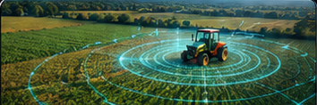

<!-- ===================== BANNER ANIMADO ===================== -->
<!-- Gerado por .github/scripts/gerar_banner_neon.py -->

  

  
  
  

<!-- ===================== SOBRE MIM + TECH STACK ===================== -->
<table>
<tr>
<td width="55%" valign="top">

## 👾 Sobre mim

Sou estudante de **Inteligência Artificial na FIAP** e gosto de transformar dados em soluções que as pessoas conseguem usar no dia a dia.

Trabalho o ciclo completo de um projeto de IA. Começo pela **coleta e análise dos dados**, passo pelo **modelo de machine learning** e termino na **interface** que mostra o resultado, às vezes também no **hardware** que captura as informações. Já apliquei isso em problemas reais de **agronegócio** e de **cidades inteligentes**, usando dados abertos e públicos.

Também me importo com a parte que fica entre o código e as pessoas: documentação clara, arquitetura bem explicada e interfaces pensadas para quem vai usar.

</td>
<td width="45%" valign="top">

## ⚡ Tech stack

**🧠 Machine Learning & Visão Computacional** 

**📊 Dados** 

**⚙️ Automação** 

**🧩 Prototipagem (interface e hardware)** 

**🛠️ Desenvolvimento & Deploy** 

</td>
</tr>
</table>

## 💻 Hard skills

### 🧠 Machine Learning & IA
Regressão, classificação e clusterização (K-Means, DBSCAN), XGBoost, validação cruzada, Grid Search e pipeline **CRISP-DM**. Também tenho experiência com scoring de risco e estou estudando visão computacional com **YOLO**.

### 📊 Dados
Análise exploratória com Pandas, **SQL** e modelagem relacional, dashboards em **Power BI** e **R Shiny**, e consumo de APIs de dados abertos (INMET, EMBRAPA, ANA, INPE, BACEN).

### ⚙️ Automação
Expertise na criação de **automações avançadas no n8n**, integrando sistemas por APIs e webhooks, com fluxos de várias etapas e lógica condicional. Conhecimento avançado em plataformas de automação de atendimento, como a **BotConversa**.

### ☁️ Cloud
**AWS**: análise de custos entre regiões para hospedar uma API de ML, considerando os requisitos legais de armazenamento de dados. Também trabalho com arquitetura serverless.

### 🎨 Front-end & Design
Do protótipo no **Figma** à interface em **React**: dashboards por perfil de usuário, autenticação e fluxos offline.

### 🔌 IoT & Hardware
**ESP32 e Arduino** com sensores e Wi-Fi, em protótipos de irrigação inteligente e de cidades inteligentes.

<!-- ===================== PROJETOS ===================== -->
## 📂 Projetos em destaque

<table>
<tr>
<td width="50%" valign="top">
  
  <h3>🌾 FarmTech Solutions</h3>
  <b>Agricultura de precisão</b> 
  Cálculo de área e insumos por talhão, estatísticas em R e dados meteorológicos em tempo real pela API Open-Meteo.  
  
  
</td>
<td width="50%" valign="top">
  
  <h3>🌱 Classificação de Sementes</h3>
  <b>Machine Learning com CRISP-DM + demo em Streamlit</b> 
  SVM que identifica três variedades de trigo (Kama, Rosa e Canadian) pelas medidas do grão, com F1 de 0,96 na validação cruzada, análise de erros e app interativo.  
  
  
  
</td>
</tr>
</table>

## 🤝 Soft skills

- ✍️ **Comunicação escrita:** textos claros e objetivos, de documentação técnica a relatórios para quem não é da área
- 🗣️ **Comunicação técnica:** explico modelos e resultados de forma acessível, em READMEs, diagramas e apresentações
- 📈 **Apresentação de dados para times:** transformo análises em insights que apoiam decisões
- 🧑‍💼 **Vivência em ambiente corporativo:** conduzo reuniões, alinho expectativas com diferentes áreas e lido bem com prazos e prioridades
- 🚀 **Liderança de projetos:** organizo entregas do planejamento à execução e coordeno pessoas em torno de um objetivo
- 🤝 **Trabalho em equipe:** entregas em sprints e projetos colaborativos
- 🧭 **Visão de produto:** começo pelo problema e pelo usuário, não pela ferramenta
- 🔍 **Atenção aos detalhes:** trabalho de forma iterativa, refinando até ficar certo
- 📚 **Aprendizado contínuo:** estou sempre estudando algo novo, hoje com foco em visão computacional
- 🌎 **Inglês avançado**

---

## 📈 Atividade

<!-- Gerado automaticamente pelo workflow .github/workflows/snake.yml -->
<picture>
  <source media="(prefers-color-scheme: dark)" srcset="https://raw.githubusercontent.com/tamiresvferreira/tamiresvferreira/output/github-contribution-grid-snake-dark.svg"/>
  <source media="(prefers-color-scheme: light)" srcset="https://raw.githubusercontent.com/tamiresvferreira/tamiresvferreira/output/github-contribution-grid-snake.svg"/>
  
</picture>

  Feito em pixel, um quadradinho de cada vez 🩷

